# contrib-tetris

<picture>
  <source media="(prefers-color-scheme: dark)" srcset="https://raw.githubusercontent.com/KenYanL/contrib-tetris/main/demo/tetris-contrib-dark.svg" />
  <source media="(prefers-color-scheme: light)" srcset="https://raw.githubusercontent.com/KenYanL/contrib-tetris/main/demo/tetris-contrib.svg" />
  
</picture>

A demo with randomly generated contributions, rebuilt by falling bricks.

*Reusable GitHub Action that renders a contribution graph as falling Tetris and LEGO bricks and writes one animated light SVG and one animated dark SVG.*

Contribution Brickfall (formerly Contribution Tetris) is a reusable GitHub Action that draws a contribution graph as falling Tetris bricks with LEGO studs. Pieces drop in and lock on the days they belong to, so the resting frame is the real calendar. Light and dark are separate animated SVGs, pure SVG and CSS, about 50KB each, with no extra packages.

That preview is this HTML:

```html
<picture>
  <source media="(prefers-color-scheme: dark)" srcset="https://raw.githubusercontent.com/KenYanL/contrib-tetris/main/demo/tetris-contrib-dark.svg" />
  <source media="(prefers-color-scheme: light)" srcset="https://raw.githubusercontent.com/KenYanL/contrib-tetris/main/demo/tetris-contrib.svg" />
  
</picture>
```

Those files are committed in `demo/`. `scripts/make_demo.py` rebuilds them from a fixed random seed. `sample/` is a pinned copy of KenYanL's calendar for 2025-10-12 through 2026-10-17 (168 contributions).

See [CHANGELOG.md](CHANGELOG.md) for the history of this action.

## Use it

```yaml
name: Generate contribution tetris

on:
  schedule:
    - cron: "41 7 * * *"
  workflow_dispatch:

permissions:
  contents: write

jobs:
  generate:
    runs-on: ubuntu-latest
    steps:
      - uses: actions/checkout@v4

      - uses: KenYanL/contrib-tetris@v1
        with:
          github_user_name: ${{ github.repository_owner }}
          svg_light_path: dist/tetris-contrib.svg
          svg_dark_path: dist/tetris-contrib-dark.svg
          # calendar_json: path/to/contributions.json  # optional; skip the API and render a saved calendar
          # token: ${{ secrets.GITHUB_TOKEN }}  # optional; defaults to the workflow token; unused with calendar_json
          # seed: "1"                            # optional; omit for the stable pack
          # speed: "1.0"                         # optional; 2 plays twice as fast, 0.5 at half speed
          # palette: default                     # optional; halloween, christmas, newyear, valentine, lunarnewyear, or auto

      - name: Publish SVGs to the output branch
        uses: crazy-max/ghaction-github-pages@v5
        with:
          target_branch: output
          build_dir: dist
        env:
          GITHUB_TOKEN: ${{ secrets.GITHUB_TOKEN }}
```

Put this in the profile README. Swap in the repository that owns the `output` branch:

```html
<picture>
  <source media="(prefers-color-scheme: dark)" srcset="https://raw.githubusercontent.com/YOUR_USERNAME/YOUR_USERNAME/output/tetris-contrib-dark.svg" />
  <source media="(prefers-color-scheme: light)" srcset="https://raw.githubusercontent.com/YOUR_USERNAME/YOUR_USERNAME/output/tetris-contrib.svg" />
  
</picture>
```

The public contribution calendar is readable with the default workflow token. To render a saved calendar JSON instead (and skip the API), set `calendar_json` to a workspace-relative `.json` path such as `demo/contributions.json`.

### Inputs

| Input | Required | Default | Description |
| --- | --- | --- | --- |
| `github_user_name` | yes | | GitHub login whose calendar is drawn. When `calendar_json` is set, this still overrides the username label in that JSON. |
| `calendar_json` | no | | Workspace-relative path to a saved contribution calendar JSON (same shape as `sample/contributions.json` / `demo/contributions.json`). When set, the action reads that file instead of calling the GitHub API, so `token` is unused. Must not be empty, must not contain `..`, and must end in `.json`. Omit to fetch the live calendar for `github_user_name`. |
| `svg_light_path` | no | `dist/tetris-contrib.svg` | Where to write the light SVG. |
| `svg_dark_path` | no | `dist/tetris-contrib-dark.svg` | Where to write the dark SVG. |
| `token` | no | workflow token | Token for the GraphQL contribution query. Unused when `calendar_json` is set. |
| `seed` | no | `0` | Same seed, same bricks. `0` is the stable pack. |
| `speed` | no | `1.0` | Animation speed. `1` is the normal pace. `2` plays twice as fast and `0.5` plays at half speed. The bricks stay the same. |
| `palette` | no | `default` | Contribution colors for both SVGs. `default` is the usual green graph. `halloween` uses GitHub's Halloween colors. `christmas` uses [Coolors' most popular Christmas palette](https://coolors.co/palettes/popular/christmas). `newyear` uses [Color Hunt's gold gradient palette](https://colorhunt.co/palette/f9e6a8f2a900cc6f004d2a00). `valentine` uses [SchemeColor's Valentine's Hearts palette](https://www.schemecolor.com/valentines-hearts.php). `lunarnewyear` uses [SchemeColor's Chinese Gold & Red palette](https://www.schemecolor.com/chinese-gold-red.php). `auto` uses Halloween on 31 October (UTC), Christmas on 24-26 December (UTC), New Year's Day on 1 January (UTC), Valentine's Day on 14 February (UTC), Lunar New Year on the festival day and the two following UTC days for 2026-2035, and green every other UTC day. When a Chinese traditional festival and a Western holiday share a UTC day, `auto` starts on the Chinese palette and fades into the Western one (14 February 2029 fades from `lunarnewyear` to `valentine`). `lunarnewyear>valentine` paints that fade on any day. A year outside that table stays green. 1 January stays `newyear`. |

Invalid values fail the step before any SVG is written. The message names the input and a valid example: a GitHub login, an optional workspace-relative `.json` calendar path such as `sample/contributions.json`, two different workspace-relative `.svg` paths, a non-empty token when fetching live, a `seed` from -2147483648 to 2147483647, a positive `speed` such as `1`, `2`, or `0.5`, and a `palette` of `default`, `halloween`, `christmas`, `newyear`, `valentine`, `lunarnewyear`, `auto`, or a fade such as `lunarnewyear>valentine`.

### Outputs

| Output | Description |
| --- | --- |
| `svg_light_path` | Path of the light SVG that was written. |
| `svg_dark_path` | Path of the dark SVG that was written. |

## FAQ

### How do I show it on a profile README?

Paste the `<picture>` block from [Use it](#use-it) into the README of the repository that publishes the SVGs. For a GitHub profile, that repository is `YOUR_USERNAME/YOUR_USERNAME`. The first `<source>` is the dark SVG (`prefers-color-scheme: dark`), the second is the light SVG, and the `` is the light file. Those URLs load the files from the `output` branch: `https://raw.githubusercontent.com/OWNER/REPO/output/tetris-contrib.svg` and `tetris-contrib-dark.svg`.

### Which branch do the SVGs get published to, and why?

The action writes both files in the job workspace. The defaults are `dist/tetris-contrib.svg` and `dist/tetris-contrib-dark.svg`. The example workflow then publishes the `dist/` directory to a branch named `output` with `crazy-max/ghaction-github-pages`, so those SVGs sit at the root of that branch and the raw URLs above resolve. `main` stays the action source. This repo's [`.github/workflows/tetris.yml`](.github/workflows/tetris.yml) publishes the seeded `demo/` calendar (via `calendar_json: demo/contributions.json`) to `output` on the daily schedule, on `workflow_dispatch`, and on pushes to `main`. It does not fetch or publish anyone's live contribution graph. Pull requests run the test job only.

### How often does it update, and how do I change the schedule?

The schedule is the workflow's cron. The example and this repo both use `41 7 * * *` (07:41 UTC every day). Both also set `workflow_dispatch`, so the workflow can be run from the Actions tab. Change that cron to change how often the SVGs are regenerated.

### What token and permissions does it need?

`token` defaults to the calling workflow's `GITHUB_TOKEN` (`${{ github.token }}`). When `calendar_json` is omitted, the action sends that token as a bearer token to `https://api.github.com/graphql` and reads that login's contribution calendar. The public calendar is readable with that default token. An empty token fails the step when fetching live. When `calendar_json` is set, the action reads that JSON file instead and does not use `token`. Publishing the `output` branch needs `contents: write` on the job that pushes. The example sets that at the workflow level. This repo's workflow leaves the default at `contents: read` and sets `contents: write` only on the publish job.

### Why is the name Contribution Brickfall when usage is `uses: KenYanL/contrib-tetris@v1`?

`name: Contribution Brickfall` in [`action.yml`](action.yml) is the display name. The action was formerly Contribution Tetris. `uses:` selects the repository and the ref, which are still `KenYanL/contrib-tetris` and `v1`, so the workflow line stays `uses: KenYanL/contrib-tetris@v1`.

### How big are the files, and does it install anything?

The action installs nothing. It runs `generate.py` with Python 3.10 or newer from the standard library, which `ubuntu-latest` already has. Each result is pure SVG and CSS (no `<script>`). The pinned sample in `sample/` is 45,354 bytes (light) and 45,357 bytes (dark). `generate.py` prints the byte size of each file as it writes it.

### What happens with an empty or very small calendar?

Days with no activity are still drawn. Level 0 is a flat square with no stud, and the caption is the real total: `0 contributions in the last year`, or `1 contribution in the last year` when the total is 1. If the API returns no days, the action fails with `no contribution days returned for <login>`. An unknown login fails with `GitHub user '<login>' was not found`. A rejected token or a network error fails with the GitHub error. In each of those cases the step prints that reason and writes no SVG. The board is 7 rows by the weeks in the profile window (53 in the pinned sample), and every cell is covered. When `7 × weeks` is not divisible by 4, the leftover cells are a tromino, a domino, or a single brick. The pinned 53-week sample leaves 3 such cells.

## How it is drawn

The profile grid is 7 rows by about 53 weeks. Those cells are packed into I, O, T, S, Z, L, and J tetrominoes, rotations included. `7 × columns` is not always divisible by 4, so the remainder becomes a tromino, domino, or single brick. Each cell keeps that day's contribution level. Days with activity get a stud and a bevel; empty days stay flat squares. One CSS animation drops the pieces. If animation is disabled, the finished graph remains.

Colors follow the contribution graph shipped on github.com. The default palette is Primer `--contribution-default-bgColor-0` through `-4`: light `#eff2f5 #aceebb #4ac26b #2da44e #116329`, dark `#151b23 #033a16 #196c2e #2ea043 #56d364`.

`palette: halloween` (CLI: `--palette halloween`) paints both SVGs with Primer `--contribution-halloween-bgColor-1` through `-4` from [@primer/primitives](https://github.com/primer/primitives) 11.10.0 (`dist/css/functional/themes/light.css` and `dark.css`). Level 0 keeps `--contribution-default-bgColor-0`, because the Halloween tokens start at level 1. Light `#eff2f5 #f0db3d #ffd642 #f68c41 #1f2328`, dark `#151b23 #fac68f #c46212 #984b10 #e3d04f`. On the dark graph that is pale peach, orange, burnt orange, then yellow.

`palette: christmas` (CLI: `--palette christmas`) paints both SVGs from [Coolors' most popular Christmas palette](https://coolors.co/palettes/popular/christmas) (`386641`, `6a994e`, `a7c957`, `f2e8cf`, `bc4749`). The cream `#f2e8cf` is dropped. Level 0 again keeps `--contribution-default-bgColor-0`, so empty cells stay the neutral GitHub background and the graph stays readable. The other four colors are ordered by contrast against that background. Light `#eff2f5 #a7c957 #6a994e #bc4749 #386641`, dark `#151b23 #386641 #bc4749 #6a994e #a7c957`.

`palette: newyear` (CLI: `--palette newyear`) paints both SVGs from [Color Hunt's gold gradient palette](https://colorhunt.co/palette/f9e6a8f2a900cc6f004d2a00) (`#f9e6a8`, `#f2a900`, `#cc6f00`, `#4d2a00`). Level 0 again keeps `--contribution-default-bgColor-0`, so empty cells stay the neutral GitHub background and the graph stays readable. The other four colors are ordered by contrast against that background. Light `#eff2f5 #f9e6a8 #f2a900 #cc6f00 #4d2a00`, dark `#151b23 #4d2a00 #cc6f00 #f2a900 #f9e6a8`.

`palette: valentine` (CLI: `--palette valentine`) paints both SVGs from [SchemeColor's Valentine's Hearts palette](https://www.schemecolor.com/valentines-hearts.php) (`#f7aee8`, `#fd647c`, `#f6383a`, `#d81a37`). Level 0 again keeps `--contribution-default-bgColor-0`, so empty cells stay the neutral GitHub background and the graph stays readable. The four source colors are used exactly, lightest to darkest. Light `#eff2f5 #f7aee8 #fd647c #f6383a #d81a37`, dark `#151b23 #d81a37 #f6383a #fd647c #f7aee8`.

`palette: lunarnewyear` (CLI: `--palette lunarnewyear`) paints both SVGs from [SchemeColor's Chinese Gold & Red palette](https://www.schemecolor.com/chinese-gold-red.php) (`#960316`, `#ebc862`, `#e4b034`, `#ca9d08`, `#c50100`, `#830010`). Scarlett `#960316` and Chinese Gold `#ca9d08` are dropped as near-duplicates. Level 0 again keeps `--contribution-default-bgColor-0`, so empty cells stay the neutral GitHub background and the graph stays readable. The other four colors run from lightest to darkest. Light `#eff2f5 #ebc862 #e4b034 #c50100 #830010`, dark `#151b23 #830010 #c50100 #e4b034 #ebc862`.

`palette: auto` (CLI: `--palette auto`) uses the Halloween colors on 31 October UTC, the Christmas colors on 24, 25, and 26 December UTC, the New Year colors on 1 January UTC, the Valentine colors on 14 February UTC, the Lunar New Year colors on the festival day and the two following UTC days, and the default green palette on every other UTC date, including 31 December and 2 January. When a Chinese traditional festival and a Western holiday share a UTC day, `auto` starts on the Chinese palette and then fades into the Western palette after the bricks have landed, so both holidays are visible in one loop. 14 February 2029 falls inside the Lunar New Year window, so that day fades from `lunarnewyear` to `valentine`. 14 February in other years, including 2032 (the day after that year's 11-13 February window), stays the Valentine palette with no fade. 1 January stays the New Year palette. `palette: lunarnewyear>valentine` (CLI: `--palette lunarnewyear>valentine`) paints that same fade on any day. Lunar New Year does not fall on the same Gregorian day each year, so those days come from a fixed table of UTC dates for 2026-2035. The dates are the first day of the first lunar month in the [Hong Kong Observatory Gregorian-Lunar conversion tables](https://www.hko.gov.hk/en/gts/time/conversion.htm): 2026-02-17, 2027-02-06, 2028-01-26, 2029-02-13, 2030-02-03, 2031-01-23, 2032-02-11, 2033-01-31, 2034-02-19, and 2035-02-08. Christmas covers three UTC days, so Lunar New Year uses that same length: the tabulated day and the next two (17-19 February 2026, and 31 January through 2 February 2033 when the festival is on 31 January). A year that is not in the table, such as 2025 or 2036, stays on the green graph for Lunar New Year. The check is that calendar day in UTC: the Gregorian date in the Observatory table, on the UTC clock. Omit `palette` to keep the green graph on every day, including those holidays.

## Develop

No third-party packages. Python 3.10 or newer.

```bash
python3 -m unittest test_brickfall.py
python3 generate.py --input sample/contributions.json --out dist
python3 generate.py --username KenYanL --token "$GITHUB_TOKEN" --out dist
python3 generate.py --input sample/contributions.json --out dist --palette halloween
python3 generate.py --input sample/contributions.json --out dist --palette christmas
python3 generate.py --input sample/contributions.json --out dist --palette newyear
python3 generate.py --input sample/contributions.json --out dist --palette lunarnewyear
python3 generate.py --input sample/contributions.json --out dist --palette valentine
python3 generate.py --input sample/contributions.json --out dist --palette lunarnewyear>valentine
python3 generate.py --input sample/contributions.json --out dist --palette auto
```

`--palette` is the same choice as the action's `palette` input. `auto` reads the UTC date when the process starts. Halloween is 31 October. Christmas is 24, 25, and 26 December. New Year's Day is 1 January. Valentine's Day is 14 February. Lunar New Year is the tabulated UTC date and the two following days, for 2026-2035 only. When those dates coincide, the graph starts in the Chinese festival colors and fades into the Western holiday colors. `lunarnewyear>valentine` paints that fade on any day.

`.github/workflows/tetris.yml` runs the tests on every push and pull request. On a daily cron (`41 7 * * *`), on `workflow_dispatch`, and on pushes to `main`, it renders the seeded `demo/contributions.json` calendar (username label `demo`) and writes:

- `tetris-contrib.svg`
- `tetris-contrib-dark.svg`

to the `output` branch only. It does not fetch a live contribution calendar.

## Prior art & credits

Similar projects exist. None of their code is copied or wrapped. This generator was written for this repo.

| Project | License | What it does | How this differs |
| --- | --- | --- | --- |
| [debba/gh-contributions-tetris-gif-maker](https://github.com/debba/gh-contributions-tetris-gif-maker) | MIT | Single 1×1 cells fall down each column into place. GIF only, Python/Pillow. | Whole tetrominoes (with smaller leftovers) lock into the real 7×53 grid. Pure SVG/CSS, light and dark. |
| [leereilly/contribution-graph-art](https://github.com/leereilly/contribution-graph-art) | none | Tetrominoes fall through the graph as decoration. They do not build it. | Pieces land on the exact cells of the contribution calendar and stay there until the loop resets. |
| [JuhaP2/contribution-tetris](https://github.com/JuhaP2/contribution-tetris) | MIT | A bot plays a real game on a 10×20 board. | The board is the contribution grid, not a separate Tetris well. |
| [arndom/github-contribution-tetris](https://github.com/arndom/github-contribution-tetris) | MIT, archived | Splits a graph into tetrominoes for a game you play in the browser. | The split is automatic and played back as a README SVG. No game loop to play. |
| [Sur1ive/contribution-fx](https://github.com/Sur1ive/contribution-fx) | MIT | Gravity, plus other effects: cells drop to the bottom of the column and float back. | Cells do not pile up at the bottom. Each brick locks in its real week and weekday. |

The idea that a contribution grid can be shown as falling blocks is shared with those projects. The packer, the LEGO studs, the SVG timeline, and the workflow are separate.

## License

[MIT](LICENSE). Copyright (c) 2026 KenYanL.
